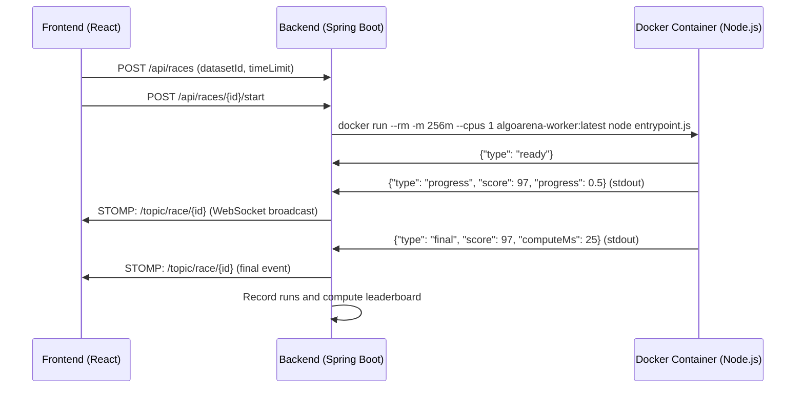

# AlgoArena

**AlgoArena** is a high-performance, real-time algorithmic benchmarking platform designed to pit combinatorial optimization and heuristic algorithms against one another in containerized sandboxes. It features live WebSocket metric streaming, convergence telemetry, interactive race controls (pause, resume, cancel), and a modern dark analytics dashboard.

---

## Key Features

- **Concurrent Sandboxed Execution**: Runs each algorithm concurrently in isolated Docker containers with hard limits on CPU (`1 core`) and memory (`256 MB`).
- **Real-Time Live Race Telemetry**: Streams iterations, scores, and progress events in real-time over WebSockets (STOMP) directly to an interactive convergence chart and live leaderboard.
- **5 Built-In Scheduling Algorithms**:
  - **Branch & Bound** (`branch_and_bound`): Exact branch-and-bound search finding the provably optimal makespan.
  - **Genetic Algorithm** (`genetic`): Population-based metaheuristic using tournament selection, crossover, and mutation.
  - **Simulated Annealing** (`simulated_annealing`): Probabilistic metaheuristic with exponential cooling schedule.
  - **Longest Processing Time** (`lpt`): Greedy heuristic prioritizing large jobs first.
  - **Shortest Job First** (`greedy`): Greedy heuristic prioritizing short jobs first.
- **Precision Race Controls**: Pause and resume live races using `docker pause` / `docker unpause` without counting paused wall time against algorithm compute budgets or deadlines.
- **Universal Dataset Importer**: Drag-and-drop or paste datasets in JSON, CSV, TSV, or plain text (e.g. `label,number`, `id,duration`, or list of numbers). Automatically parses and formats them to the benchmark schema.
- **Dark Analytics UI**: Designed with a responsive dark SaaS aesthetic, glowing status tags, and real-time Recharts visualizations.

---

## Tech Stack

| Component | Technology |
|---|---|
| **Frontend** | React 18, Vite 5, Recharts, `@stomp/stompjs`, Vanilla CSS |
| **Backend** | Java 21, Spring Boot 3.3.2, Spring Security (JWT), Spring Data JPA, Spring WebSocket |
| **Database** | PostgreSQL 15+ |
| **Sandboxing** | Docker (`node:22-alpine` worker image) |

---

## Repository Structure

```
AlgoArena/
├── backend/                   # Spring Boot application
│   ├── src/main/java/         # Controllers, services, models, repositories, execution engine
│   └── src/main/resources/    # application.yml and config
├── frontend/                  # React + Vite application
│   ├── src/
│   │   ├── components/        # LiveRace, CreateRaceWizard, Leaderboard, ConvergenceChart, etc.
│   │   ├── hooks/             # useRace WebSocket & polling hook
│   │   ├── api.js             # REST API client
│   │   ├── utils.js           # Formatters & algorithm color palette
│   │   └── styles.css         # Custom design system
├── workers/                   # Algorithm worker scripts & Docker container definition
│   ├── Dockerfile             # Alpine-based worker image
│   └── scheduling/            # branch_and_bound.js, genetic.js, greedy.js, lpt.js, simulated_annealing.js
├── docs/                      # Database schema and SQL migrations
│   ├── schema.sql             # Base schema
│   └── migrations/            # Incremental schema patches (pause/resume columns)
└── tools/                     # Development and testing utilities (listen-race.js)
```

---

## Prerequisites

Ensure you have the following installed:

- **Java 21+** and **Maven 3.9+**
- **Node.js 20+** and **npm**
- **Docker Desktop** (with daemon running)
- **PostgreSQL 15+**

---

## Setup & Getting Started

### 1. Database Configuration

Start PostgreSQL and set up the `algoarena` database and user:

```bash
# Connect to PostgreSQL
psql -U postgres

# Create database and user
CREATE USER algoarena WITH PASSWORD 'algoarena';
CREATE DATABASE algoarena OWNER algoarena;
GRANT ALL PRIVILEGES ON DATABASE algoarena TO algoarena;
```

Apply the schema and migrations:

```bash
PGPASSWORD=algoarena psql -h localhost -U algoarena -d algoarena -f docs/schema.sql
PGPASSWORD=algoarena psql -h localhost -U algoarena -d algoarena -f docs/migrations/004_pause.sql
```

### 2. Build the Worker Docker Image

Build the sandboxed worker image that executes algorithm scripts:

```bash
docker build -t algoarena-worker:latest ./workers
```

### 3. Start the Backend

From the `backend` directory:

```bash
cd backend
mvn spring-boot:run
```

The Spring Boot backend will run on `http://localhost:8081`. Database entities and default algorithms (`scheduling` problem type and the 5 algorithms) will be seeded on startup.

### 4. Start the Frontend

From the `frontend` directory:

```bash
cd frontend
npm install
npm run dev
```

Open your browser at `http://localhost:5173`.

---

## Default Credentials

For local development and testing:
- **Username**: `harsha`
- **Password**: `password123`

You can also register a new account via the frontend authentication screen.

---

## How It Works

### Race Lifecycle & Docker Execution



1. **Dataset Import**: The user imports or selects a benchmark instance (CSV, JSON, or plain text).
2. **Race Creation**: A new race record is created and linked with each algorithm registered for the problem type.
3. **Execution Service**: The backend spawns isolated Docker containers for all participating algorithms concurrently.
4. **Event Protocol**:
   - Algorithms write JSON lines to `stdout`:
     - `{"type": "ready"}`: Signals that input parsing is complete and compute timer starts.
     - `{"type": "progress", "iteration": ..., "score": ..., "progress": ...}`: Emits intermediate best scores.
     - `{"type": "final", "score": ..., "computeMs": ..., "payload": ...}`: Final solution and output.
5. **Watchdog Thread**: Monitors active containers, enforces maximum wall time limits, handles cancellation, and tracks paused durations.

---

## REST API Summary

| Method | Endpoint | Description |
|---|---|---|
| `POST` | `/api/auth/login` | Authenticate and retrieve JWT token |
| `POST` | `/api/auth/register` | Register a new user |
| `GET` | `/api/datasets` | List available benchmark datasets |
| `POST` | `/api/datasets` | Upload a new benchmark dataset |
| `GET` | `/api/races` | List recent races |
| `POST` | `/api/races?datasetId={id}&timeLimitSeconds={sec}` | Create a new race |
| `POST` | `/api/races/{id}/start` | Start all algorithm runs for the race |
| `POST` | `/api/races/{id}/pause` | Freeze running containers (`docker pause`) |
| `POST` | `/api/races/{id}/resume` | Unfreeze containers (`docker unpause`) |
| `POST` | `/api/races/{id}/stop` | Cancel the running race |
| `GET` | `/api/races/{id}/state` | Get full status snapshot of all runs |
| `GET` | `/api/races/{id}/events?after={eventId}` | Fetch events emitted after a specific ID |

---

## WebSocket Protocol

- **Endpoint**: `ws://localhost:8081/ws/websocket`
- **Topic**: `/topic/race/{raceId}`
- **Subscribed Events**:
  - `started`: Run started execution.
  - `progress`: Algorithm emitted an improved score or progress increment.
  - `final`: Algorithm concluded execution.
  - `timed_out` / `cancelled` / `failed`: Run stopped or errored.

---

## License

This project is licensed under the MIT License.
