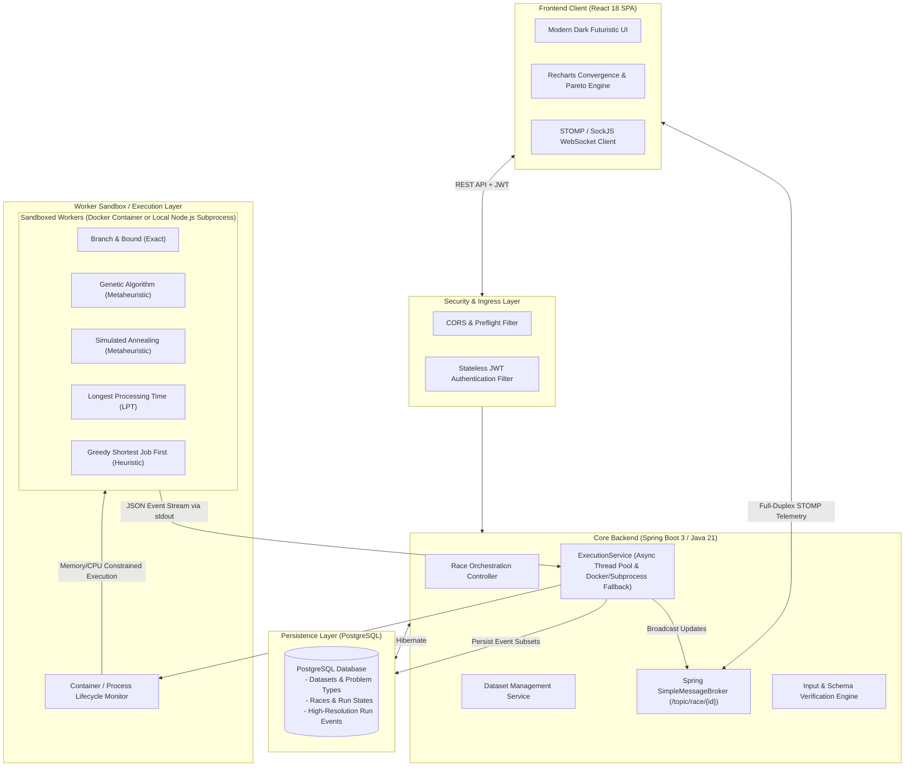

# AlgoArena 🏁

**Enterprise-Grade Real-Time Algorithmic Benchmarking & Telemetry Platform**

*A Major Final-Year Capstone Project in Distributed Systems & Empirical Algorithmics*

[Architecture](https://www.google.com/search?q=%23system-architecture) •
[Features](https://www.google.com/search?q=%23key-features) •
[Algorithms](https://www.google.com/search?q=%23supported-algorithms--paradigms) •
[API Reference](https://www.google.com/search?q=%23api-specification) •
[Cloud Deployment](https://www.google.com/search?q=%23free-cloud-deployment) •
[Getting Started](https://www.google.com/search?q=%23getting-started-local)

---

## 📌 Executive Summary

Theoretical asymptotic complexity ($\mathcal{O}$-notation) often obscures the empirical wall-clock efficiency, cache dynamics, and memory overhead of algorithms operating on real-world problem instances.

**AlgoArena** is a distributed, full-stack benchmarking platform designed to empirically evaluate, visualize, and compare competing algorithmic paradigms in real time. Users upload custom problem instances (e.g., multiprocessor makespan scheduling), launch concurrent isolated executions, and monitor sub-second convergence trajectories, event streams, and Pareto trade-off frontiers over full-duplex WebSockets.

---

## 🏛 System Architecture

The platform follows an asynchronous, event-driven architecture built around strict process isolation, robust fallback mechanisms, and sub-second telemetry broadcast:



---

## ⚡ Key Features

* **Real-Time WebSocket Telemetry**: Stream real-time score updates, node iterations, and active compute timestamps directly to the browser via STOMP over WebSockets.
* **Dynamic Convergence Curves**: Interactive step-after convergence tracking showing optimality progress over wall-clock milliseconds.
* **Pareto Frontier Optimality Analysis**: Automatic computation of the speed-versus-quality Pareto frontier, highlighting which algorithm delivers the best solution per millisecond of compute.
* **Adaptive Sandboxed Execution**: Primary containerized isolation via Docker (`--memory`, `--cpus`, `--pids-limit`, `--cap-drop ALL`, `--read-only`), paired with an automatic fallback to local Node.js subprocesses with OS signal control for cloud environments without nested Docker daemons.
* **Interactive Race Controls**: Real-time **Pause**, **Resume**, and **Cancel** controls leveraging container freeze primitives or process signal controls (`SIGSTOP`/`SIGCONT`) and atomic timeout watchdogs.
* **Automated Data Validation & Ingestion**: Ingests custom `.json`, `.csv`, `.tsv`, and `.txt` files with intelligent column and format inference.
* **Global Historical Leaderboards**: Aggregate win rates, average gap-to-bound percentages, and historical convergence rates across standard benchmark datasets.
* **Complete Report Export**: Export detailed JSON race summaries containing full audit logs, iteration metrics, and schedule payload assignments.

---

## 🧬 Supported Algorithms & Paradigms

For the NP-hard **Multiprocessor Makespan Scheduling Problem** ($P \parallel C_{\max}$):

| Algorithm | Paradigm | Theoretical Guarantee | Best For |
| --- | --- | --- | --- |
| **Branch & Bound** | Exact Branch-and-Bound | Optimal ($0.00\%$ gap guaranteed) | Small-to-medium instances ($n \le 30$) requiring mathematical proof of optimality |
| **Genetic Algorithm** | Population Metaheuristic | Asymptotically optimal via crossover & mutation | Large, complex instances where high solution diversity is required |
| **Simulated Annealing** | Thermodynamic Metaheuristic | Escapes local minima via Boltzmann acceptance | Non-convex solution spaces with deep local optima |
| **Longest Processing Time (LPT)** | Approximation Algorithm | $\frac{4}{3} - \frac{1}{3m}$-approximation bound | Fast polynomial-time execution with deterministic error bounds |
| **Greedy Heuristic (SJF)** | Greedy / Constructive | Heuristic local assignment | Ultra-fast baseline initialization |

---

## 🛠 Tech Stack

### Frontend

* **Core**: React 18, React DOM, Vite 5
* **Visualizations**: Recharts (Convergence charts, scatterplots, historical win-rate trajectories)
* **Real-Time Telemetry**: `@stomp/stompjs` WebSocket client
* **Styling**: Pure semantic CSS3 with CSS custom properties (Dark cyberpunk design system)

### Backend

* **Framework**: Spring Boot 3.3.2, Java 21 (LTS)
* **Data Access**: Spring Data JPA, Hibernate, HikariCP
* **Security**: Spring Security, Stateless JWT (`io.jsonwebtoken:jjwt`)
* **Real-Time Messaging**: Spring WebSocket, Simple STOMP Broker
* **Validation**: Jakarta Bean Validation
* **JSON Processing**: Jackson Databind

### Infrastructure & Workers

* **Database**: PostgreSQL 16 (Hosted on Neon.tech serverless)
* **Worker Runtime**: Node.js 22 (Alpine-based sandboxed workers / local subprocess fallback)
* **Cloud Deployment**: Render (Backend Web Service) + Vercel / Render Static Site (Frontend SPA)

---

## 🔌 API Specification

### Authentication

* `POST /api/auth/register` — Register a new account (`username`, `email`, `password`)
* `POST /api/auth/login` — Authenticate and receive a signed JWT token
* `GET /api/me` — Retrieve the currently authenticated principal

### Datasets

* `GET /api/datasets` — List all benchmark datasets
* `GET /api/datasets/{id}` — Retrieve a specific dataset instance
* `POST /api/datasets` — Upload and validate a new problem dataset

### Races & Execution

* `GET /api/races` — List all historical races
* `POST /api/races?datasetId={id}&timeLimitSeconds={sec}` — Initialize a new race
* `GET /api/races/{id}/state` — Fetch complete race status and run standings
* `GET /api/races/{id}/events?after={eventId}` — Incremental polling fallback for events
* `POST /api/races/{id}/start` — Launch all algorithm runs in parallel
* `POST /api/races/{id}/pause` — Pause execution of all active runs
* `POST /api/races/{id}/resume` — Resume execution of paused runs
* `POST /api/races/{id}/stop` — Cancel the race and terminate active processes/containers

### WebSockets

* `Endpoint`: `/ws` (supports raw WebSocket + SockJS fallback)
* `Subscription`: `/topic/race/{raceId}` (receives real-time `RunProgressEvent` payloads)

---

## 🚀 Getting Started (Local)

### Prerequisites

* **Java**: JDK 21+
* **Node.js**: v18+ and npm
* **PostgreSQL**: PostgreSQL 14+ running on port `5432`
* **Docker** *(Optional)*: Docker Desktop for containerized sandboxing

### 1. Database Setup

Create the PostgreSQL database:

```sql
CREATE DATABASE algoarena;
CREATE USER algoarena WITH PASSWORD 'algoarena';
GRANT ALL PRIVILEGES ON DATABASE algoarena TO algoarena;

```

### 2. Backend Setup

```bash
cd backend
mvn clean package -DskipTests
java -jar target/backend-0.1.0.jar

```

*Backend runs on `http://localhost:8081`.*

### 3. Frontend Setup

```bash
cd frontend
npm install
npm run dev

```

*Open `http://localhost:5173` in your browser.*

---

## 🌐 Free Cloud Deployment

AlgoArena is configured for 100% free cloud hosting:

| Layer | Recommended Free Host | Config Reference |
| --- | --- | --- |
| **Frontend** | Vercel or Render Static Site | [`frontend/vercel.json`](https://www.google.com/search?q=./frontend/vercel.json) |
| **Backend** | Render Web Service (Docker runtime with Java 21 + Node.js) | [`Dockerfile`](https://www.google.com/search?q=./Dockerfile), [`backend/src/main/resources/application-prod.yml`](https://www.google.com/search?q=./backend/src/main/resources/application-prod.yml) |
| **Database** | Neon.tech (Serverless Postgres) | [`docs/schema.sql`](https://www.google.com/search?q=./docs/schema.sql) |

---

## 📂 Repository Structure

```
AlgoArena/
├── backend/                              # Spring Boot 3 + Java 21 REST & WebSocket API
│   ├── src/main/java/com/algoarena/
│   │   ├── config/                       # Security, CORS, WebSocket, and DataSeeder
│   │   ├── controller/                   # REST API Controllers (Auth, Dataset, Race)
│   │   ├── dto/                          # Data Transfer Objects
│   │   ├── execution/                    # Docker / Subprocess Process Orchestration
│   │   ├── model/                        # JPA Entities (User, Dataset, Race, Run, RunEvent)
│   │   ├── repository/                   # Spring Data JPA Repositories
│   │   ├── security/                     # JWT Authentication & Authorization Filters
│   │   └── service/                      # Business Logic & Input Validation
│   └── src/main/resources/
│       ├── application.yml               # Development Configuration
│       └── application-prod.yml          # Production Cloud Configuration
├── frontend/                             # React 18 + Vite SPA
│   ├── public/                           # Static assets and favicon
│   ├── src/
│   │   ├── components/                   # UI Views (Race Dashboard, Wizard, Leaderboards)
│   │   ├── hooks/                        # useRace WebSocket STOMP subscription hook
│   │   ├── api.js                        # REST client with JWT interceptors
│   │   ├── styles.css                    # Dark futuristic design system
│   │   └── utils.js                      # Mathematical formatters & algorithm palettes
│   └── vercel.json                       # Vercel deployment configuration
├── workers/                              # Algorithmic Benchmark Implementations
│   ├── Dockerfile                        # Minimal sandboxed Node.js Alpine container
│   └── scheduling/                       # Scheduling Algorithms (B&B, Genetic, SA, LPT, Greedy)
├── docs/                                 # Database DDL Schemas & Versioned Migrations
├── Dockerfile                            # Root multi-stage Docker build (Java 21 + Node.js)
├── DEPLOY.md                             # Free Deployment Guide
└── README.md                             # Project Documentation

```

---

## 🎓 Capstone Project Attribution

* **Project Title**: AlgoArena — Real-Time Algorithmic Benchmarking Platform
* **Candidate**: Harshavardhan ([@Harshavardhan2006](https://github.com/Harshavardhan2006))
* **Repository**: [https://github.com/Harshavardhan2006/Algo-Arena](https://github.com/Harshavardhan2006/Algo-Arena)
* **License**: [MIT License](https://www.google.com/search?q=./LICENSE)
